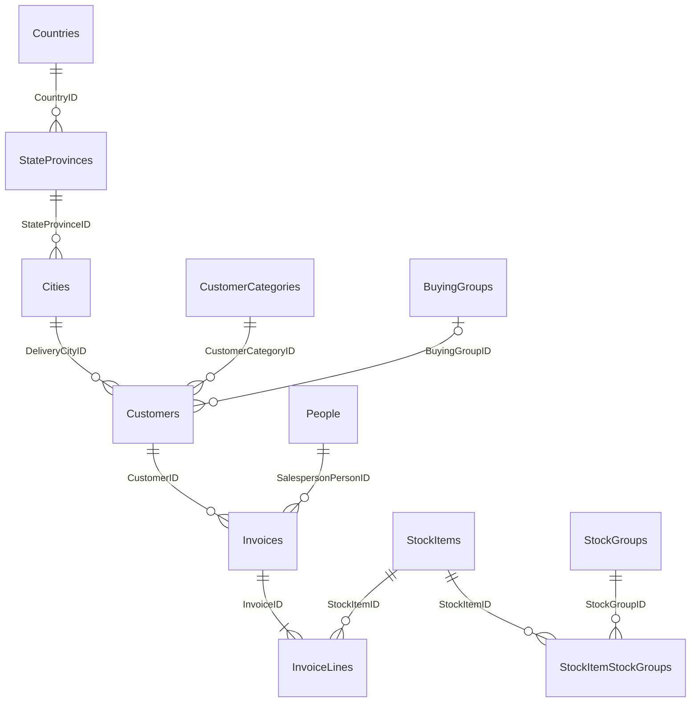

# 1. Alcance, preguntas analíticas y requerimientos

## Caso de negocio
**Wide World Importers (WWI)** es un mayorista ficticio de artículos de novedad (Microsoft sample). Su base OLTP registra pedidos, facturas, clientes, productos, inventario y compras. Está optimizada para transacciones, no para responder preguntas históricas, comparar períodos ni entrenar modelos.

## Proceso principal elegido: **Ventas facturadas**
Siguiendo la guía (“seleccionar un proceso principal y desarrollar el flujo completo”), el alcance es la venta facturada a nivel de **línea de factura** (`Sales.Invoices` + `Sales.InvoiceLines`) con sus dimensiones (cliente, producto, vendedor, geografía y fecha). Compras e inventario quedan fuera para no sacrificar la calidad del flujo principal.

### Justificación del dataset
| Criterio | WideWorldImporters |
|---|---|
| Volumen | 70 510 facturas, 228 265 líneas, 663 clientes, 227 productos, 37 940 ciudades |
| Variedad de entidades | Clientes, categorías, grupos de compra, productos, grupos de stock (N:M), personas, geografía de 4 niveles |
| Fechas | 2013-01-01 a 2016-05-31 (≈ 3,4 años, 178 semanas) → suficiente para un pronóstico semanal con estacionalidad anual |
| Complejidad | Tablas temporales (system-versioned) que permiten carga incremental por `ValidFrom` y SCD2; relación N:M artículo-grupo que obliga a controlar el grano |
| Viabilidad predictiva | 9 territorios × 178 semanas = 1 602 observaciones semanales |

Las bases `Venta`/`VentasDM` existentes en el equipo se descartaron (≈ 5 filas por tabla: insuficiente para tendencias y ML).

## Preguntas analíticas que responde la solución
1. ¿Cuánto vendimos (neto, sin impuesto), con qué ganancia y margen, en un período y cómo se compara con el período anterior?
2. ¿Qué territorios, estados y ciudades concentran las ventas? (drill-down territorio → estado → ciudad)
3. ¿Qué categorías y productos crecen o caen? (drill-down categoría → producto)
4. ¿Qué tipos de cliente y grupos de compra son más rentables? ¿Quiénes son los principales clientes?
5. ¿Cómo evolucionan las ventas por mes/semana/trimestre/año?
6. ¿Cuánto venderá cada territorio las próximas 4 semanas? (ML)
7. ¿Qué territorio presenta una caída anormal y requiere atención? (alertas)
8. Preguntas libres en lenguaje natural respaldadas por datos del DW (IA generativa).

## Requerimientos funcionales
| ID | Requerimiento | Implementación |
|---|---|---|
| RF-01 | Extraer inicial e incrementalmente desde la fuente | `etl/extraction.py` (watermark por objeto) |
| RF-02 | Conservar datos recibidos sin sobrescribir | `WWI_Staging.raw.*` append-only con `_execution_id` |
| RF-03 | Limpiar, validar, estandarizar y poner en cuarentena | `etl/catalog.py`, `etl/transformation.py`, `quarantine.RejectedRecord` |
| RF-04 | Cargar un modelo dimensional con SCD | `database/data-warehouse/03_dw_load_procs.sql` |
| RF-05 | Reconciliar conteos y montos entre capas | `ops.usp_Reconcile` |
| RF-06 | Dashboard web con autenticación, 6 KPIs, filtros, tendencias, drill-down, detalle | `frontend/` + `backend/` |
| RF-07 | Modelo predictivo con baseline y evaluación temporal | `machine_learning/` |
| RF-08 | Asistente en lenguaje natural respaldado por el DW | `generative_ai/assistant.py` |
| RF-09 | Alertas por regla, ML e IA con registro y entrega | `notifications/alerts.py` |
| RF-10 | Monitoreo operativo | Pestaña *Operación* + `/api/ops/summary` |

## Requerimientos no funcionales
| ID | Requerimiento | Cómo se cumple |
|---|---|---|
| RNF-01 Reproducibilidad | Otro integrante instala con `deployment/setup.ps1` | Scripts en orden, versiones fijadas |
| RNF-02 Seguridad | Sin secretos en el repo; mínimo privilegio; SQL parametrizado | `.env` (ignorado), `04_security.sql`, consultas con `?` |
| RNF-03 Idempotencia | Re-ejecutar no duplica | MERGE por clave natural; prueba `test_incremental_is_idempotent` |
| RNF-04 Rendimiento | Consultas del dashboard < 3 s en SQL Express local | Medido en `evidencias/05_validacion_kpis.md` |
| RNF-05 Oportunidad | Datos disponibles ≤ 15 min tras el evento | Micro-batch programado cada 15 min (`programar_pipeline.ps1`) |
| RNF-06 Trazabilidad | Linaje de cada fila | `_execution_id`, `ExecutionID`, `ops.EtlStepLog`, claves naturales en el DW |
| RNF-07 Usabilidad | Escritorio y móvil | CSS responsive (grid → 1 columna < 900 px) |

## Diagrama entidad-relación de la fuente (tablas relevantes)

Diccionario completo con tipos, nulabilidad y claves: [evidencias/02_diccionario_fuente.md](evidencias/02_diccionario_fuente.md). Perfil de columnas: [evidencias/01_perfil_fuente.md](evidencias/01_perfil_fuente.md).
