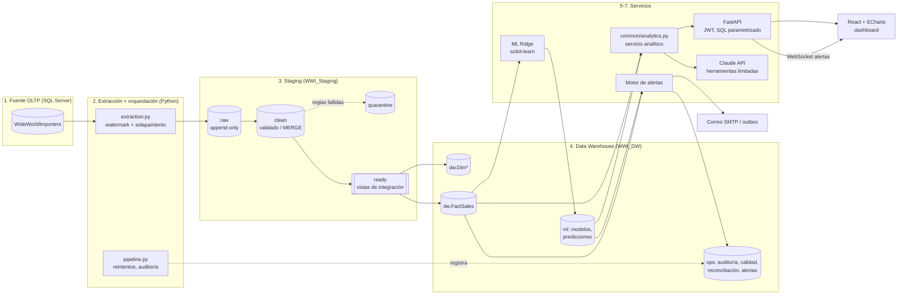

# 2. Arquitectura de la solución y decisiones técnicas

## Diagrama general

**Flujo principal:** fuente → extracción → staging raw → limpieza y validación → staging clean/ready → carga dimensional → DW → BI / ML / GenAI → alertas. El monitoreo es transversal (`ops.*`).

## Stack y justificación
| Componente | Elección | Por qué | Alternativa descartada |
|---|---|---|---|
| Fuente | WideWorldImporters (SQL Server 2025 Express) | Recomendado por la guía; tablas temporales; volumen y fechas suficientes | AdventureWorks (similar), Pagila (requiere PostgreSQL adicional) |
| Staging y DW | SQL Server, bases separadas `WWI_Staging` y `WWI_DW` | Mismo motor que la fuente → joins entre bases y transformaciones set-based; requerido por la guía | Un solo esquema (mezcla responsabilidades) |
| ETL | **Python + SQL** | La guía indica que basta para un proyecto pequeño; la lógica set-based vive en SQL (rápida) y Python orquesta, audita y reintenta. Código versionable y probado con pytest | Apache Hop (visual, pero menos testeable), SSIS (licencia/edición) |
| Orquestación | `etl/pipeline.py` + **Programador de tareas de Windows** cada 15 min | Un único flujo lineal sin dependencias complejas: Airflow agregaría Postgres, scheduler y webserver sin beneficio (guía: “Airflow se justifica cuando existen dependencias y programación complejas”) | Airflow |
| Backend | FastAPI | Tipado, validación, OpenAPI automática en `/docs`, mismo lenguaje que ETL/ML | .NET, Node |
| Frontend | React 18 + Vite + Apache ECharts | Recomendado; ECharts permite drill-down por clic | Angular, Chart.js |
| ML | scikit-learn (Ridge / HistGradientBoosting) | Suficiente para 1 602 observaciones; interpretable | XGBoost, Prophet |
| IA generativa | **Claude (API de Anthropic)**, modelo `claude-opus-5-5` con *tool use* | Herramientas tipadas → el modelo nunca escribe SQL; buena calidad en español | OpenAI, Ollama local (requiere ≥ 8 GB extra de RAM; el equipo tiene 7,7 GB) |
| Notificaciones | Web (tabla + WebSocket) y correo SMTP; sin SMTP → archivo `.eml` (entrega simulada) | Demostrable sin credenciales de correo | RabbitMQ (innecesario para el volumen) |
| Despliegue | Local con scripts PowerShell; **Docker Compose** opcional (`deployment/docker-compose.yml`) | Docker Desktop no estaba instalado; requiere privilegios de administrador | — |

## Decisiones documentadas (preguntas de la guía)
| Pregunta | Decisión |
|---|---|
| ¿Batch, incremental o eventos? | **Incremental por watermark** (`ValidFrom` en tablas temporales, `LastEditedWhen` en el resto) en micro-batch cada 15 min. CDC requiere SQL Agent (no disponible en Express). |
| ¿Staging separa originales de depurados? | Sí: `raw` (append-only, nunca se sobrescribe), `clean` (validado), `quarantine` (rechazados), `ready` (vistas integradas). |
| ¿Qué herramienta ejecuta y programa? | `python -m etl.pipeline`; programado con `deployment/programar_pipeline.ps1` (sin ejecuciones simultáneas, 2 reintentos). |
| ¿Fallas, reintentos, registros tardíos? | Reintento con backoff exponencial ante errores transitorios; watermark solo avanza si toda la ejecución termina bien; ventana de solapamiento de 5 min; registros en cuarentena por integridad (p. ej. línea sin cabecera) se **reintentan automáticamente** en cada carga. |
| ¿Cómo se actualizan hechos y dimensiones? | MERGE por clave natural (`InvoiceLineID`, `CustomerID`…). Cliente: SCD2 (categoría, grupo, ciudad) + SCD1 (nombre, crédito). Producto, empleado y geografía: SCD1. Hechos con miembro desconocido se re-resuelven cuando llega la dimensión. |
| ¿Eliminaciones? | En WWI las facturas no se eliminan (las correcciones serían notas de crédito, inexistentes en el dataset; regla R-IL-01). Si existieran, se detectarían comparando claves fuente vs `clean` y marcando baja lógica; documentado como extensión. |
| ¿Frecuencia del dashboard? | Datos con latencia ≤ 15 min (micro-batch); la fecha/hora de la última carga se muestra en la cabecera. |
| ¿Qué significa “tiempo real”? | **No** se afirma tiempo real: el ETL es micro-batch de 15 min. Las alertas se publican al dashboard por WebSocket en ≤ 5 s *después* de generarse. Los eventos de demo se marcan como SIMULADOS. |
| ¿Qué corre en contenedores? | En Compose: SQL Server, API, ETL (tarea), frontend (nginx). Localmente todo corre nativo. |

## Estructura del repositorio (equivalencia con la guía)
| Guía | Repositorio |
|---|---|
| documentation/ | `documentation/` (+ `evidencias/` generadas) |
| database/ (source, staging, data-warehouse, scripts) | `database/00_create_databases.sql`, `staging/`, `data-warehouse/`, `security/` |
| etl/ (extraction, transformation, loading, orchestration) | `etl/extraction.py`, `transformation.py` + `catalog.py` + `quality.py`, `loading.py`, `pipeline.py` |
| frontend/ · backend/ | `frontend/` (React) · `backend/app/` (FastAPI) + `common/analytics.py` |
| machine-learning/ | `machine_learning/` (features, train, predict, models) |
| generative-ai/ · notifications/ | `generative_ai/` · `notifications/` |
| tests/ · deployment/ | `tests/` (pytest) · `deployment/` (PowerShell, Docker, Compose) |

> Los directorios Python usan guion bajo (`machine_learning`) porque Python no permite importar módulos con guion.

## Costos
| Elemento | Costo |
|---|---|
| SQL Server Express, Python, React, scikit-learn, ECharts | Gratis |
| API de Claude | Pago por uso (Opus 5.5: USD 4 / millón de tokens de entrada, USD 20 / millón de salida). Una pregunta típica usa 2-4 llamadas con ≈ 5-15 mil tokens → del orden de centavos de dólar. Alternativa gratuita: `ANTHROPIC_MODEL=claude-haiku-5-5` (más barato) o reemplazar por Ollama local con más RAM. |
| Correo | Gratis en modo outbox; un proveedor SMTP real puede tener costo |
