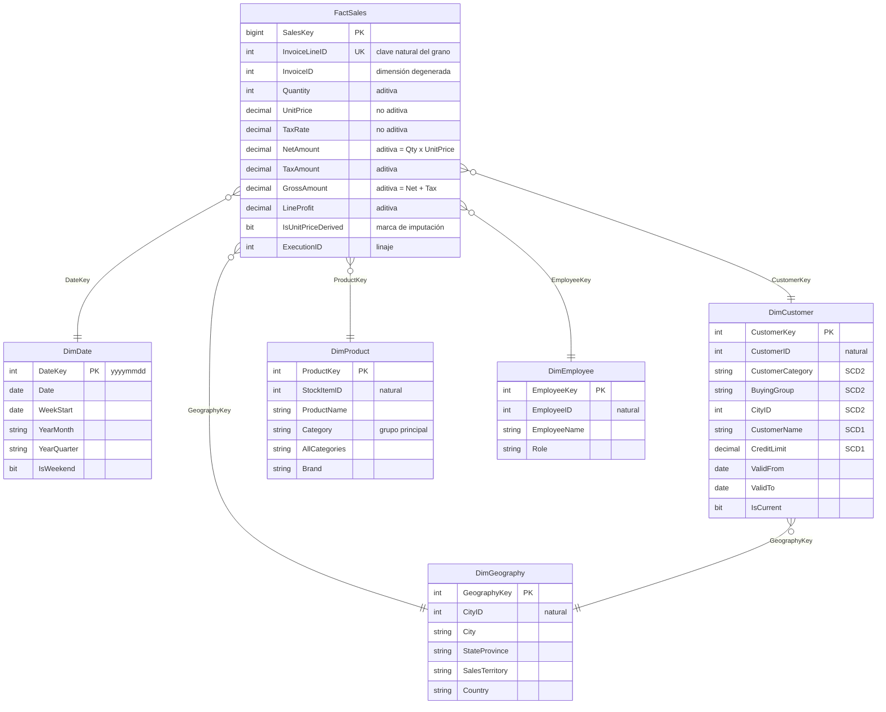

# 3. Modelo dimensional y Data Warehouse

## Proceso de diseño (Kimball)
1. **Proceso de negocio:** ventas facturadas.
2. **Grano:** *una fila de `dw.FactSales` = una línea de factura* (`Sales.InvoiceLines.InvoiceLineID`). No se mezclan filas por factura con filas por línea; los conteos de facturas se calculan con `COUNT(DISTINCT InvoiceID)`.
3. **Dimensiones:** cuándo (DimDate), quién compra (DimCustomer), qué (DimProduct), quién vende (DimEmployee), dónde (DimGeography).
4. **Hechos:** cantidad, precio, impuesto, importe neto/bruto y ganancia.
5. **Claves sustitutas** `IDENTITY` en cada dimensión; se conservan las **claves naturales** (`CustomerID`, `StockItemID`, `CityID`, `EmployeeID`, `InvoiceLineID`, `InvoiceID`) para trazabilidad.
6. **Historia:** SCD2 en cliente; SCD1 en el resto (justificado abajo).
7. **Pruebas:** grano único, SCD sin solapes, reconciliación de conteos y montos (ver `tests/test_etl_pipeline.py`).

Se eligió **Star Schema**: la única normalización tentadora (producto → grupo de stock) es N:M, y normalizarla multiplicaría medidas; se resolvió con una categoría principal desnormalizada.

## Diagrama (estrella)

Diagrama editable: este bloque Mermaid (se edita como texto y se renderiza en GitHub/VS Code). Diccionario completo: [evidencias/03_diccionario_dw.md](evidencias/03_diccionario_dw.md).

## Definición de medidas
| Medida | Fórmula | Tipo | Nota |
|---|---|---|---|
| Quantity | `InvoiceLines.Quantity` | Aditiva | |
| NetAmount (ventas netas) | `ExtendedPrice − TaxAmount` (= Quantity × UnitPrice) | Aditiva | Medida principal de los KPIs y del ML |
| TaxAmount | `InvoiceLines.TaxAmount` | Aditiva | |
| GrossAmount | `ExtendedPrice` | Aditiva | Validado: Gross = Net + Tax (DQ-06) |
| LineProfit | `InvoiceLines.LineProfit` | Aditiva | |
| UnitPrice, TaxRate | atributos de la línea | **No aditivas** | se promedian ponderadas, nunca se suman |
| Margen % | `Σ LineProfit / Σ NetAmount` | **No aditiva** | se recalcula en cada agregación |
| Ticket promedio | `Σ NetAmount / COUNT(DISTINCT InvoiceID)` | **No aditiva** | |
| *Semi-aditiva (ejemplo)* | saldo de inventario (`StockItemHoldings`) | sumable por producto, **no** en el tiempo | Fuera del alcance (inventario); se menciona como concepto |

## Estrategia SCD
| Dimensión | Tipo | Atributos | Justificación |
|---|---|---|---|
| DimCustomer | **SCD2** | CustomerCategory, BuyingGroup, CityID/GeographyKey | Analizar ventas según la categoría/ubicación que el cliente tenía *en ese momento* |
| DimCustomer | SCD1 | CustomerName, CreditLimit, PaymentDays, IsOnCreditHold | Correcciones; no cambian el análisis histórico |
| DimProduct, DimEmployee, DimGeography | SCD1 | todos | Cambios poco frecuentes y sin necesidad analítica de historia en el alcance |

Detalles: primera versión vigente desde `1900-01-01`; un cambio cierra la versión (`ValidTo = fecha efectiva`, `IsCurrent = 0`) e inserta otra; el rango es semiabierto `[ValidFrom, ValidTo)`; si la versión vigente empezó el mismo día se corrige en sitio (evita versiones de duración cero). Índice único filtrado garantiza **una sola versión vigente** por cliente. Los hechos resuelven el cliente por **vigencia a la fecha de factura**.

Evidencia: el cliente 1 cambió de categoría en la simulación → [evidencias/04_resultados_carga.md](evidencias/04_resultados_carga.md#scd-tipo-2--clientes-con-historia).

## Miembro desconocido
Cada dimensión tiene la fila `-1 = 'Desconocido'`. Un hecho sin dimensión correspondiente se carga con `-1` (no se pierde el importe) y en cada carga posterior se re-resuelve (corrige dimensiones tardías). La métrica DQ-07 cuenta estos casos.

## Carga y reconciliación
Orden: DimDate → DimGeography → DimCustomer → DimProduct → DimEmployee → FactSales → reconciliación. Las claves se resuelven **antes** de insertar hechos. El único join 1:N (cabecera → líneas) respeta el grano; el N:M producto-grupo se resolvió con una sola categoría. Reconciliación esperada: `fuente = clean + cuarentena pendiente` y `clean = DW` en filas y monto neto.

| Capa | Filas | Monto neto |
|---|---|---|
| Ver tabla actualizada | [evidencias/04_resultados_carga.md](evidencias/04_resultados_carga.md#reconciliación-última) | |

Scripts: `database/data-warehouse/02_dw_schema.sql` (tablas, índices, constraints, vistas) y `03_dw_load_procs.sql` (cargas idempotentes y reconciliación).
