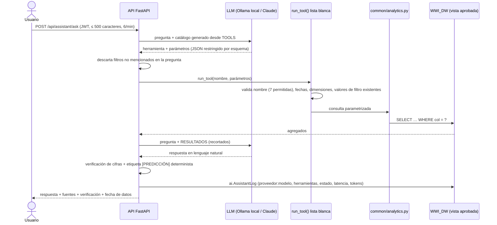

# 7. Inteligencia Artificial Generativa: asistente analítico

## Caso de uso
Asistente de lenguaje natural (pestaña *Asistente IA*) que responde preguntas sobre ventas, compara períodos, explica indicadores, consulta pronósticos y alertas y sugiere análisis. También redacta la explicación de alertas de severidad alta (marcada como generada por IA).

## Proveedores (intercambiables con `LLM_PROVIDER`)
| Proveedor | Configuración | Ventajas | Limitaciones |
|---|---|---|---|
| **Ollama local (predeterminado)** | `LLM_PROVIDER=ollama`, `OLLAMA_MODEL=qwen2.5:1.5b` | Sin costo; **ningún dato sale del equipo**; ~1 GB de RAM | Modelo pequeño: errores de interpretación y de etiquetado (ver resultados); 15-60 s por respuesta en CPU |
| Anthropic Claude (alternativa) | `LLM_PROVIDER=anthropic`, `ANTHROPIC_API_KEY`, `ANTHROPIC_MODEL=claude-opus-5-5` | Mayor calidad | Pago por uso; los agregados consultados se envían a la nube. **No se evaluó** en este proyecto (sin API key) |

### Instalación de Ollama
```powershell
winget install Ollama.Ollama            # o https://ollama.com/download
ollama pull qwen2.5:1.5b                # ~1 GB
curl http://localhost:11434/api/tags    # debe listar qwen2.5:1.5b
```
Variables (`.env`): `OLLAMA_BASE_URL` (recomendado `http://127.0.0.1:11434`: con `localhost` Windows intenta primero IPv6 y cada llamada tarda ~2 s más; en Docker `http://host.docker.internal:11434`), `OLLAMA_TOOL_MODE`, `OLLAMA_NUM_CTX`, `OLLAMA_NUM_PREDICT`, `OLLAMA_TIMEOUT`, `OLLAMA_KEEP_ALIVE`. Estado: `GET /api/assistant/status` → `{proveedor, modelo, configurado, detalle}`.

### Límites de memoria y tiempo
| Parámetro | Valor | Efecto |
|---|---|---|
| `OLLAMA_NUM_CTX` | 8 192 tokens | Tamaño de la caché KV en RAM (Ollama trunca en silencio si el contexto es menor que el prompt; por eso se fija explícitamente) |
| `OLLAMA_NUM_PREDICT` | 768 (respuesta), 300 (planificación) | Máximo de tokens generados por llamada |
| `ASSISTANT_TOOL_RESULT_MAX_CHARS` | 6 000 | Recorte de cada resultado de herramienta (se avisa al modelo y se marca `recortado` en la traza) |
| `ASSISTANT_MAX_TURNS` | 5 | Máximo de pasos por pregunta |
| `OLLAMA_TIMEOUT` | 300 s (conexión 5 s) | Si se supera, error claro (503), nunca respuesta simulada |
| `OLLAMA_KEEP_ALIVE` | 5 min | El modelo se descarga de memoria tras 5 min sin uso |
| `temperature` | 0 | Respuestas reproducibles |

## Arquitectura segura


**El modelo no ejecuta SQL ni accede libremente a la base.** Solo puede elegir una de 7 herramientas (`estado_datos`, `obtener_kpis`, `ventas_por_dimension`, `tendencia`, `comparar_periodos`, `pronostico`, `alertas_recientes`), definidas **una sola vez** en `TOOLS`. Del mismo origen se generan el formato de Claude, el formato nativo de Ollama (`ollama_tools()`) y el esquema JSON del planificador (`_planner_schema()`, enum con los 7 nombres + `ninguna`). Toda ejecución pasa por `run_tool()`.

### Modos de herramientas con Ollama (`OLLAMA_TOOL_MODE`)
- **`json` (predeterminado):** el modelo devuelve `{"herramienta", "parametros"}` con **salida estructurada** (Ollama restringe la generación al esquema). Luego se ejecuta la herramienta y se pide la redacción con los resultados. Si `run_tool()` rechaza los parámetros, el error vuelve al modelo para que corrija (hasta 4 intentos; una llamada repetida se corta).
- **`native`:** *tool calling* nativo de Ollama. En pruebas con `qwen2.5:1.5b` y las 7 herramientas, el modelo **no llamó herramientas en 11 de 12 intentos** (respondía pidiendo datos), por eso no es el modo predeterminado. Recomendado solo con modelos de 7B o más.

### Controles añadidos para el modelo pequeño (deterministas, en el servidor)
| Problema observado en pruebas | Control |
|---|---|
| Rellenaba filtros opcionales con ejemplos de las descripciones (“Plains”, “Clothing”) → respuesta sobre un subconjunto | En modo `json`, un filtro solo se aplica si su valor **aparece en la pregunta**; si no, se descarta y queda en la traza (`filtros_descartados`) |
| Enviaba filtros inexistentes (“Nacional”, “Europe”) → KPIs en 0 | `run_tool()` trata valores genéricos (“todos”, “nacional”, “total”…) como “sin filtro” y **rechaza** valores que no existen en el DW, devolviendo la lista válida |
| No interpretaba “último trimestre” | El servidor calcula el último trimestre y mes completos y los incluye en el prompt |
| Etiquetaba pronósticos como [DATO] | Si se usó `pronostico`, el servidor agrega una nota fija `[PREDICCIÓN]` con la versión del modelo de ML |
| Inventaba o mal-escalaba cifras | Verificación automática de cifras (abajo) |

## Verificación automática de cifras (`generative_ai/verification.py`)
Compara cada número de ≥ 4 dígitos de la respuesta con los números devueltos por las herramientas en esa conversación (admite redondeos por prefijo; ignora años). Resultado en `verificacion`: `verificada`, `cifras_no_verificadas` o `sin_respaldo` (hay cifras pero no se consultó el DW). Si hay advertencia, el estado pasa a `ok_con_advertencias` y se agrega al texto: “⚠ Verificación automática: …”.

**No es infalible:** no revisa porcentajes ni números de menos de 4 dígitos; un error de escala que conserve los mismos dígitos iniciales pasa (caso real observado: “274.026.600 unidades” en lugar de 2.740.266); un cálculo correcto del modelo puede marcarse como no verificado; no valida afirmaciones cualitativas.

## Controles de calidad y seguridad (guía → implementación)
| Requisito | Implementación |
|---|---|
| Restringir a datos autorizados | Lista blanca de 7 herramientas → vista aprobada `dw.vw_SalesAnalytics`; consultas parametrizadas |
| Validar entradas y limitar tamaño/frecuencia | Pydantic (1–500 caracteres), 6 preguntas/min/usuario, máx. 5 pasos, parámetros validados en `run_tool()` |
| No enviar datos personales a servicios externos | Con Ollama nada sale del equipo; con Claude solo agregados |
| Mostrar fecha de actualización | `datos_actualizados` en cada respuesta |
| Distinguir hechos, predicciones e interpretaciones | Etiquetas solicitadas al modelo + nota `[PREDICCIÓN]` determinista |
| Respaldar con métricas y períodos | Traza de herramientas y parámetros en cada respuesta + verificación de cifras |
| Responder “no hay datos suficientes” | Herramienta `ninguna` + instrucción explícita; casos 9, 10 y 12 de la batería |
| Registrar consultas | `ai.AssistantLog` con `proveedor:modelo`, herramientas, estado, latencia, tokens y error (también las fallas) |
| Proveedor caído | 503 con mensaje claro (“No se pudo conectar con Ollama…”, “ollama pull…”, “no respondió en N s”); nunca se simula una respuesta |

## Pruebas
- Automatizadas: `tests/test_ollama_integration.py` (Ollama simulado con `httpx.MockTransport` para ser deterministas; las herramientas sí consultan el DW real) + 1 prueba contra el Ollama real.
- Batería de 12 preguntas contra el modelo real: `python -m generative_ai.eval_assistant` → [evidencias/06_pruebas_asistente.md](evidencias/06_pruebas_asistente.md).

### Resultados de la batería (qwen2.5:1.5b, modo json)
| Medición | Resultado |
|---|---|
| Criterio automático (herramienta adecuada + cifras presentes en los datos + valor de referencia SQL) | 10/12 |
| **Revisión manual contra SQL independiente** | **5 correctas, 3 parciales, 4 fallidas** |
| Casos sin datos / fuera de alcance / inyección (9, 10, 12) | 3/3 correctos |
| Preguntas que ejecutaron SQL fuera de las herramientas | 0 |
| Latencia por pregunta | 6 s a 127 s (media ≈ 27 s); en una corrida previa una pregunta tardó 258 s |

Fallas típicas: período equivocado (“último trimestre” → año completo), signo mal interpretado (“disminución” cuando subió), comparación con el período equivocado y errores de escala/etiquetado. El detalle de cada respuesta y la revisión manual están en [evidencias/06_pruebas_asistente.md](evidencias/06_pruebas_asistente.md). **Conclusión honesta:** la integración, las restricciones de seguridad y el manejo de errores funcionan; la *calidad analítica* de `qwen2.5:1.5b` es insuficiente para usar sus respuestas sin revisar las fuentes. Un modelo local de 7B o Claude deberían mejorarla (no medido).

## Límites
- `qwen2.5:1.5b` es un modelo pequeño: elige mal herramientas o períodos en preguntas compuestas y comete errores de etiquetado/escala. Las salvaguardas impiden que acceda a datos no autorizados, pero **no garantizan** respuestas correctas; el usuario debe revisar las fuentes mostradas.
- Latencia de 7 s a más de 4 min por pregunta en CPU.
- La explicación de alertas con Ollama usa el mismo modelo y tiene la misma calidad limitada.
- La pantalla del asistente muestra el proveedor y modelo activos y, si no está disponible, el detalle real enviado por `/api/assistant/status` (p. ej. “No se pudo conectar con Ollama…”).
- La explicación de alertas con Ollama **se probó contra el modelo real** (`qwen2.5:1.5b`): 11–13 s por alerta y cifras correctas (p. ej., caída de 43,2 % en Far West). La explicación no menciona que la semana evaluada contiene datos simulados. La alternativa con Claude no se probó en vivo (sin API key).
