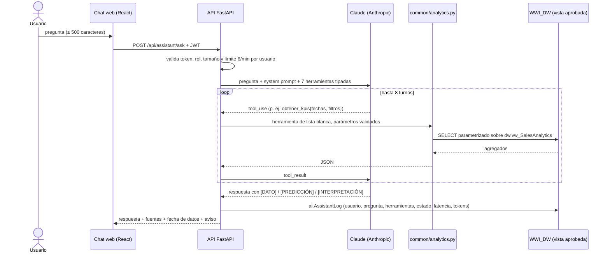

# 7. Inteligencia Artificial Generativa: asistente analítico

## Caso de uso
Asistente de lenguaje natural (pestaña *Asistente IA*) que responde preguntas sobre ventas, resume cambios entre períodos, explica indicadores, consulta pronósticos y alertas, y sugiere análisis adicionales. También redacta la **explicación de alertas de severidad alta** (marcada como generada por IA).

## Arquitectura segura

**El modelo no tiene acceso irrestricto ni ejecuta SQL.** Solo puede pedir 7 herramientas: `estado_datos`, `obtener_kpis`, `ventas_por_dimension`, `tendencia`, `comparar_periodos`, `pronostico`, `alertas_recientes`. Cada una valida fechas, dimensiones (lista blanca) y tamaños antes de consultar con parámetros. Una herramienta inexistente o parámetros inválidos devuelven `is_error` al modelo (pruebas `test_assistant_rejects_tools_outside_whitelist`, `test_assistant_tool_validates_parameters`).

## Proveedor y configuración
| Parámetro | Valor |
|---|---|
| SDK | `anthropic` 2.8.0 (Python oficial) |
| Modelo | `claude-opus-5-5` (configurable con `ANTHROPIC_MODEL`) |
| Esfuerzo | `output_config.effort = medium` (configurable); `low` para explicar alertas |
| Fallback | `fallbacks: "default"` (beta `server-side-fallback-2026-07-01`): si el modelo rechaza por política, la API reintenta en un modelo alternativo; se registra el modelo que respondió |
| Credencial | `ANTHROPIC_API_KEY` en `.env` (nunca en el repositorio). Sin credencial, la API responde 503 y el resto de la plataforma sigue funcionando |

## Controles de calidad y seguridad (guía → implementación)
| Requisito | Implementación |
|---|---|
| Restringir a datos autorizados | Herramientas de lista blanca sobre la vista aprobada; cuenta `api_user` de solo lectura |
| Validar entradas y limitar tamaño/frecuencia | Pydantic (1–500 caracteres) + `RateLimiter` 6/min/usuario + máximo 8 turnos |
| No enviar datos personales | Solo se envían agregados (montos, conteos, nombres de empresa ficticios). No se extraen correos, teléfonos ni fotos |
| Mostrar fecha de actualización | Cada respuesta incluye `datos_actualizados` (última carga y rango) |
| Distinguir hechos, predicciones e interpretaciones | Etiquetas obligatorias `[DATO]`, `[PREDICCIÓN]`, `[INTERPRETACIÓN]` resaltadas en la interfaz |
| Respuestas con métricas y períodos | Regla 3 del system prompt; las fuentes (herramientas + parámetros) se muestran bajo cada respuesta |
| Responder “no hay datos suficientes” | Regla 5 del system prompt; casos 9, 10 y 12 de la batería |
| Registrar consultas | `ai.AssistantLog` (sin la respuesta completa; solo longitud, herramientas, estado, tokens, latencia) |
| Probar ambiguas / fuera de alcance / sin datos | `generative_ai/eval_assistant.py` (12 preguntas) |

## Pruebas del asistente
`python -m generative_ai.eval_assistant` ejecuta 12 preguntas (incluye 1 ambigua, 1 fuera de alcance, 1 sin datos y 1 intento de inyección). Para cada una registra resultado esperado, herramientas de respaldo, respuesta obtenida y **cifras no verificadas** (números de la respuesta que no aparecen en los datos devueltos por las herramientas). Resultado: `evidencias/06_pruebas_asistente.md` (se genera al ejecutar con API key; consume créditos).

## Límites
- La calidad depende del proveedor externo y de la disponibilidad de la API.
- “Último trimestre” se interpreta como el último período con datos (2016), no el calendario actual; el asistente lo explicita.
- La verificación automática de cifras es heurística (redondeos pueden dar falsos positivos que se revisan manualmente).
