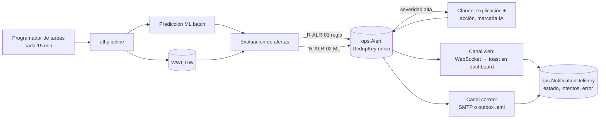

# 8. Automatización, eventos y notificaciones

## Flujo de extremo a extremo

## Disparadores
| Tipo | Regla | Severidad | Resultado |
|---|---|---|---|
| Regla de negocio (R-ALR-01) | Ventas netas de la última semana completa de un territorio caen **> 15 %** frente al promedio de las 4 semanas previas | baja < 20 % ≤ media < 30 % ≤ alta | Valor observado, referencia, umbral y período |
| Machine Learning (R-ALR-02) | Predicción h=1 del modelo activo **< 80 %** del promedio real de 13 semanas | media; alta si < 60 % | Predicción, horizonte, versión del modelo |
| IA generativa | Toda alerta **alta** recibe explicación y recomendación generadas por Claude | — | `Explanation` + `ExplanationIsAIGenerated = 1`, mostrada como “Explicación generada por IA — verificar” |

Umbrales configurables (`ALERT_DROP_THRESHOLD`, `ALERT_ML_THRESHOLD`).

## Contenido de la alerta (`ops.Alert`)
Identificador y fecha/hora (`AlertID`, `CreatedAt`), tipo y severidad, indicador y entidad, valor observado / umbral / referencia o predicción, período (`PeriodStart`–`PeriodEnd`), origen (regla, modelo con versión o IA), explicación y acción recomendada, estado (`nueva / atendida / descartada / resuelta`, editable en la interfaz), marca `IsSimulated`.

## Canales
- **Dashboard:** pestaña *Alertas* (detalle, entregas, cambio de estado) + **WebSocket** `/ws/alerts` que muestra una notificación emergente ≤ 5 s después de crearse la alerta.
- **Correo:** SMTP con STARTTLS si `SMTP_HOST` está configurado; si no, se escribe un `.eml` en `notifications/outbox/` y la entrega se registra como **SIMULADA**.

## Controles
| Requisito | Cómo |
|---|---|
| Condición verdadera y falsa | `test_drop_rule_fires_when_drop_exceeds_threshold`, `test_drop_rule_does_not_fire_at_or_below_threshold` (exactamente 15 % no dispara), `test_ml_rule_fires_only_below_ratio` |
| Sin duplicados | `DedupKey = regla|entidad|período(|modelo)` con restricción UNIQUE; re-evaluar reporta “duplicadas_omitidas” (`test_alert_deduplication`) |
| Reintentos y fallas de envío | 3 intentos con backoff; estado `fallido` + `LastError`; `python -m notifications.alerts --retry` y barrido automático de pendientes en cada evaluación |
| Registro de generación y entrega | `ops.Alert` + `ops.NotificationDelivery` (canal, destinatario, estado, intentos, detalle, fecha de entrega) |
| Consultar detalle y estado | `GET /api/alerts`, `/api/alerts/{id}/deliveries`, `PATCH /api/alerts/{id}` |

## Tiempo real
El ETL es **micro-batch cada 15 min**, por lo que la latencia máxima evento → alerta es ≈ 15 min + duración de la carga (~10 s incremental). No es tiempo real; para inmediatez se requeriría CDC (no disponible en SQL Express sin SQL Agent) o captura de eventos. En la demo:
- `python -m etl.simulate_source_changes --days 7 --territory Southeast --factor 0.4` inserta en la fuente una semana con caída del 60 % en Southeast (**SIMULADA**, facturas con `Comments='SIMULADO'`), luego el pipeline la carga y la regla la detecta.
- `python -m notifications.alerts --test` (o botón *Disparar alerta de prueba*) crea una alerta de prueba marcada como simulada.

Evidencia: [evidencias/04_resultados_carga.md#alertas-y-entregas](evidencias/04_resultados_carga.md#alertas-y-entregas) y archivos en `notifications/outbox/`.
